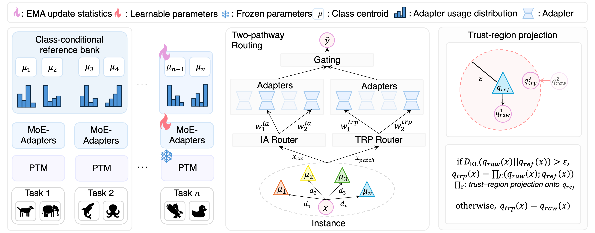

# Not All Routing Drift Is Harmful: Trust-Region Projection for Class-Incremental Learning

**The Fortieth Annual Conference on Neural Information Processing Systems (NeurIPS 2026)**

  

## News

- Our paper is accepted to NeurIPS 2026! 🎉
- Code is coming soon. Stay tuned! 🚀

## Abstract

Class-incremental learning (CIL) with pre-trained models has increasingly adopted Mixture-of-Experts (MoE) adapters, which freeze the backbone and selectively route inputs to sparse adapter subsets, achieving competitive performance through efficient parameter reuse. As new tasks are learned sequentially, however, the router's output distribution gradually shifts away from earlier states, undermining consistent adapter reuse and accelerating forgetting. Through a controlled instance-level analysis, we show that this effect is highly asymmetric, where instances with large routing drift account for most of the performance degradation, while those with small drift remain largely stable. This finding suggests that only excessive drift requires correction, while small drift need not be suppressed. Motivated by this, we propose Trust-Region Projected Routing (TRPR), which adapts the trust-region principle from constrained optimization to routing stabilization. It constrains each input's routing distribution within a KL-bounded trust region around a class-level anchor, correcting only excessive deviations while leaving small drift intact. To complement class-level anchoring with per-sample adaptability, TRPR additionally introduces an Instance-Adaptive (IA) path for fine-grained per-sample specialization, fused with the projected path via a learned gate. Extensive experiments on four CIL benchmarks show that TRPR consistently outperforms nine representative PEFT-based baselines, with accuracy gains of up to 3.06% in average and final accuracy and forgetting reduced by as much as 2.48%.
