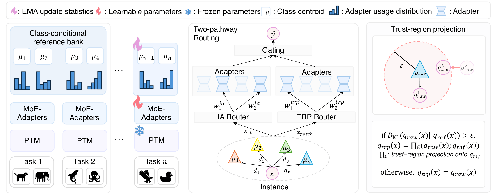
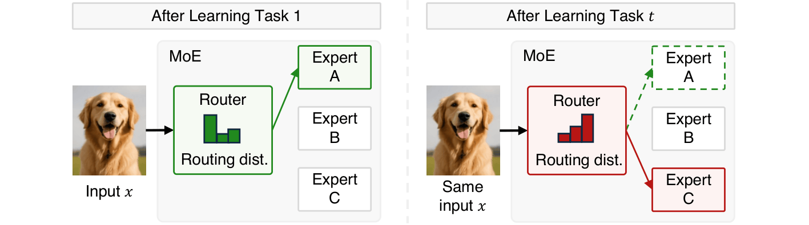
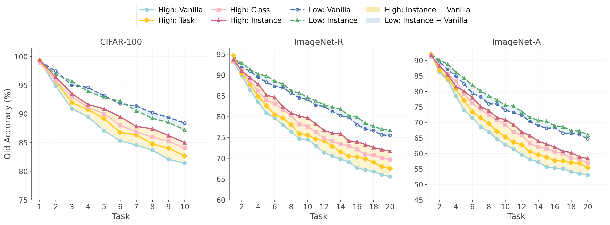
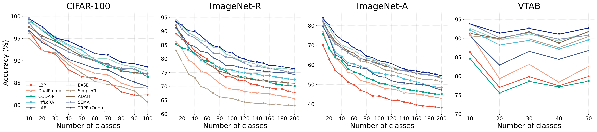
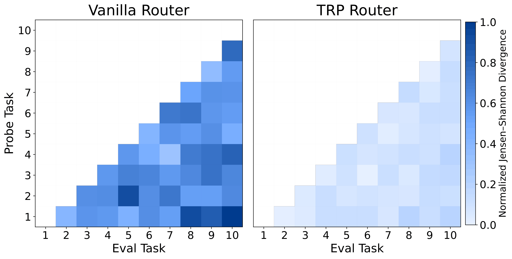

# Not All Routing Drift Is Harmful: Trust-Region Projection for Class-Incremental Learning

This repository is the official implementation of [Not All Routing Drift Is Harmful: Trust-Region Projection for Class-Incremental Learning](https://openreview.net/forum?id=WklS219u5L) (NeurIPS 2026).

**Tae-Hwan Kim, Sung-Bae Cho**<br>
Yonsei University

[Paper](https://openreview.net/forum?id=WklS219u5L) | [Contact](mailto:rlaxoghks8735@yonsei.ac.kr)

<p align="center">
  
</p>

**TL;DR**: Not all routing drift harms continual learning. TRPR corrects only excessive drift in MoE adapter routing via a KL-bounded trust-region projection around class-level references, outperforming nine PEFT-based class-incremental learning baselines.

## 💡 Abstract

Class-incremental learning (CIL) with pre-trained models has increasingly adopted Mixture-of-Experts (MoE) adapters, which freeze the backbone and selectively route inputs to sparse adapter subsets, achieving competitive performance through efficient parameter reuse. As new tasks are learned sequentially, however, the router's output distribution gradually shifts away from earlier states, undermining consistent adapter reuse and accelerating forgetting. Through a controlled instance-level analysis, we show that this effect is highly asymmetric, where instances with large routing drift account for most of the performance degradation, while those with small drift remain largely stable. This finding suggests that only excessive drift requires correction, while small drift need not be suppressed. Motivated by this, we propose Trust-Region Projected Routing (TRPR), which adapts the trust-region principle from constrained optimization to routing stabilization. It constrains each input's routing distribution within a KL-bounded trust region around a class-level anchor, correcting only excessive deviations while leaving small drift intact. To complement class-level anchoring with per-sample adaptability, TRPR additionally introduces an Instance-Adaptive (IA) path for fine-grained per-sample specialization, fused with the projected path via a learned gate. Extensive experiments on four CIL benchmarks show that TRPR consistently outperforms nine representative PEFT-based baselines, with accuracy gains of up to 3.06% in average and final accuracy and forgetting reduced by as much as 2.48%.

## 🎯 Motivation

<p align="center">
  
</p>

In MoE-based continual learning, the router gradually shifts its output distribution as new tasks are learned, so the same input can be redirected to a different adapter, disrupting consistent module reuse.

<p align="center">
  
</p>

Grouping Task-1 instances by routing-drift magnitude shows that the effect is asymmetric: instances with large drift account for most of the accuracy degradation, while those with small drift remain largely stable.

## 📊 Results

TRPR achieves the following performance with a frozen ViT-B/16 pre-trained on ImageNet-21K (mean ± std over 5 seeds).

| Benchmark | Tasks | Average Incremental Accuracy (%) | Final Accuracy (%) | Forgetting (%) ↓ |
|---|:---:|:---:|:---:|:---:|
| CIFAR-100 | 10 | 93.38 ± 0.36 | 88.27 ± 0.54 | 4.11 ± 0.31 |
| ImageNet-R | 5 | 84.34 ± 0.79 | 79.54 ± 0.44 | 3.40 ± 0.28 |
| ImageNet-R | 10 | 84.12 ± 0.45 | 78.47 ± 0.52 | 4.85 ± 0.41 |
| ImageNet-R | 20 | 82.33 ± 0.92 | 77.29 ± 0.85 | 5.34 ± 0.57 |
| ImageNet-A | 20 | 63.59 ± 0.88 | 53.12 ± 0.66 | 9.47 ± 0.72 |
| VTAB | 5 | 92.21 ± 0.43 | 90.46 ± 0.61 | 3.85 ± 0.34 |

Comparisons with nine PEFT-based baselines are reported in Table 1 of the paper.

<p align="center">
  
</p>
<p align="center">Incremental performance of different methods on class-incremental learning benchmarks.</p>

## 🔎 Analysis

<p align="center">
  
</p>
<p align="center">Task-pairwise Jensen–Shannon divergence of a vanilla MoE router and the TRP router on CIFAR-100 (10 tasks).</p>

The vanilla router shows consistently growing divergence across task pairs, whereas TRPR keeps routing divergence near zero over most regions, supporting stable adapter reuse throughout the incremental stream.

## 💻 Code

Code will be released soon.

## 📌 Citation

If you find this work useful in your research, please consider citing:

```bibtex
@inproceedings{kim2026not,
  title={Not All Routing Drift Is Harmful: Trust-Region Projection for Class-Incremental Learning},
  author={Kim, Tae-Hwan and Cho, Sung-Bae},
  booktitle={The Fortieth Annual Conference on Neural Information Processing Systems},
  year={2026}
}
```

## 📬 Contact

For questions, please contact Tae-Hwan Kim (rlaxoghks8735@yonsei.ac.kr).